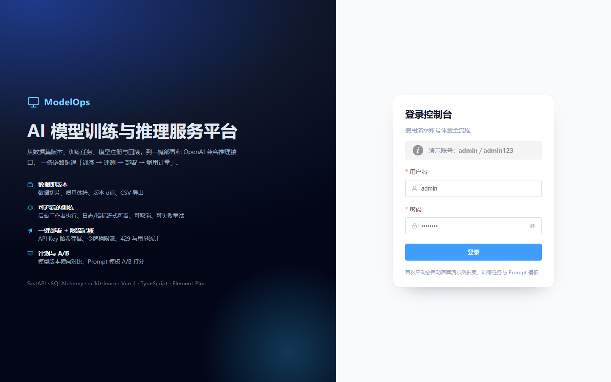
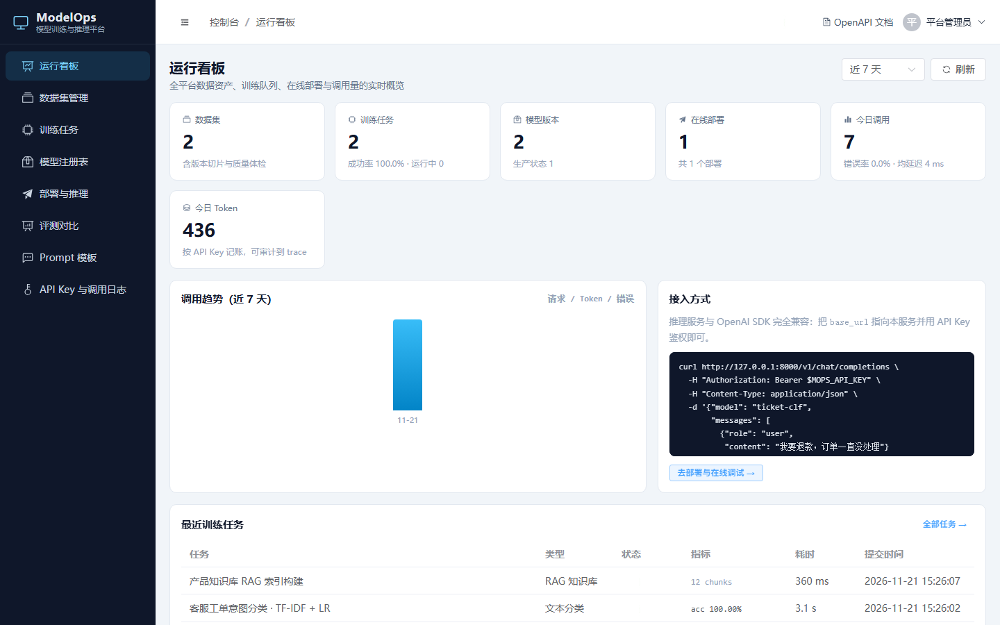
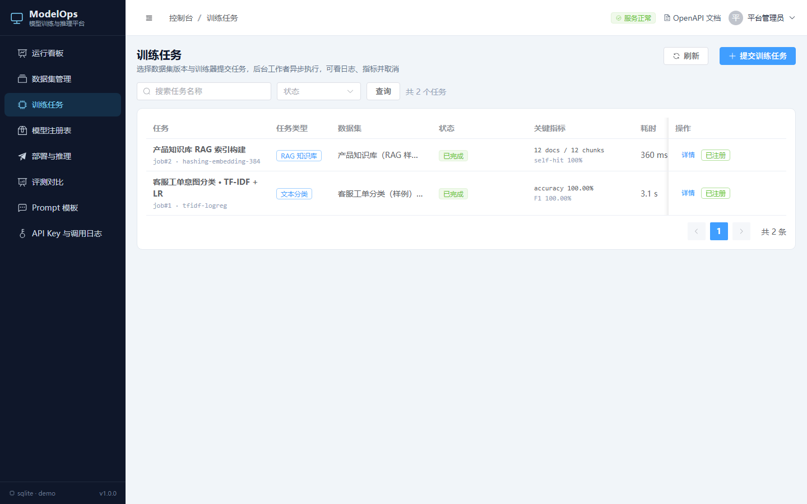
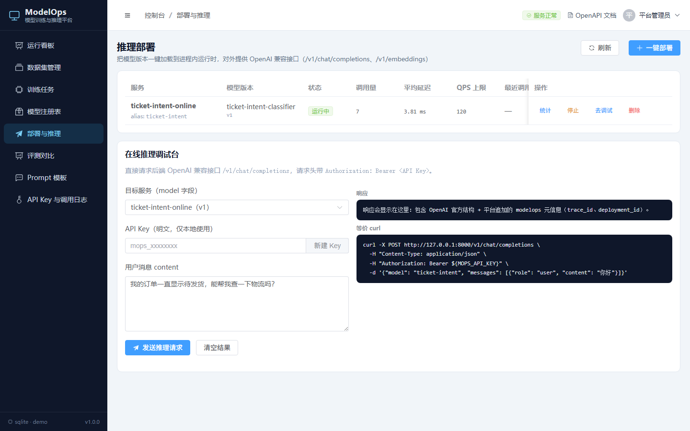
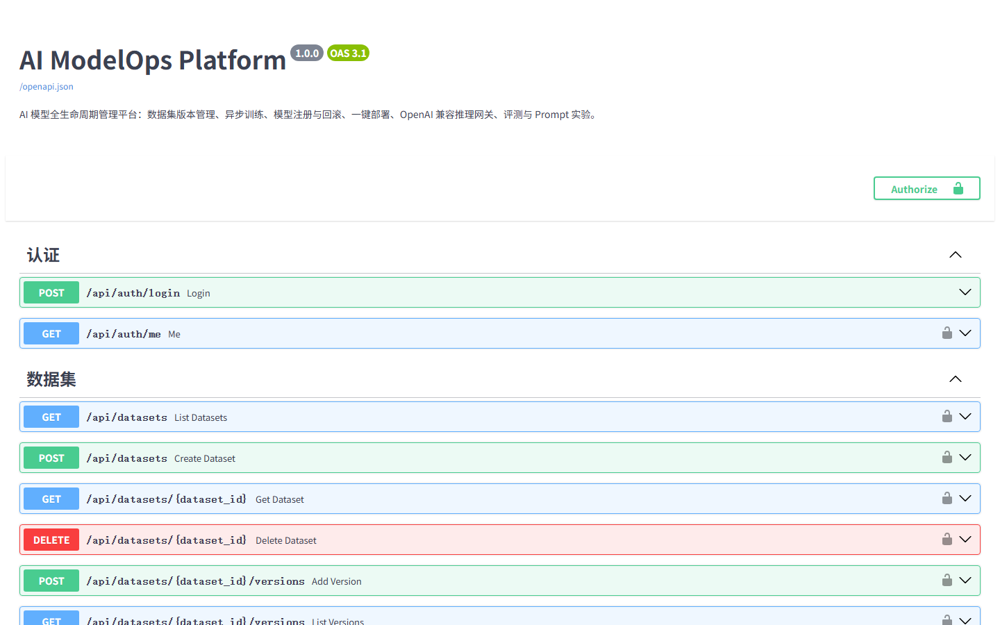
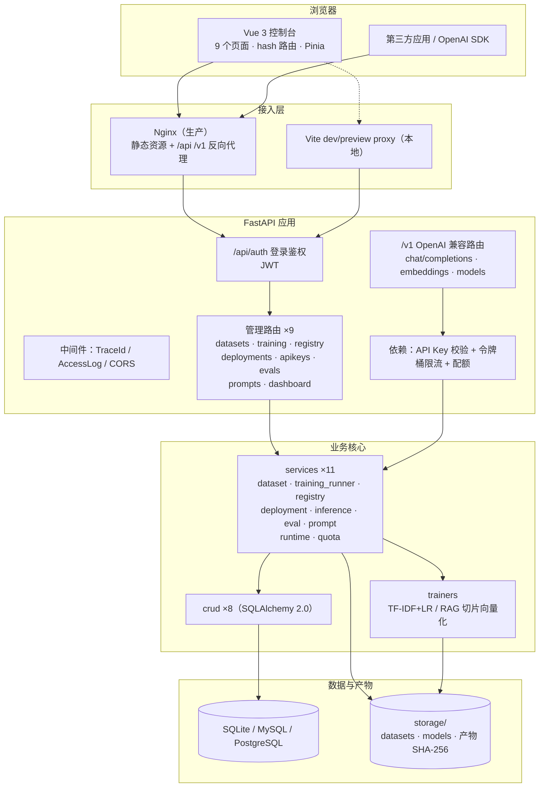

# AI ModelOps Platform · AI 模型训练与推理服务平台

一个可以直接跑起来的 **ModelOps 平台**：上传数据集 → 训练模型 → 注册版本 → 一键部署 → 用 **OpenAI 兼容接口**调用 → 采集调用日志与用量 → 做评测对比与 Prompt A/B，全流程都落在同一个 Web 控制台里。

`FastAPI` · `Vue 3` · `TypeScript` · `scikit-learn` · `SQLAlchemy` · `SQLite/MySQL/PostgreSQL` · `Docker Compose`

## 界面预览











## 为什么做这个项目

在真实 AI 团队里，"模型能训练"只是起点，真正消耗工程精力的是**把模型变成可被业务调用的服务**：数据版本怎么管理、训练任务怎么排队与取消、模型版本怎么注册与回滚、服务怎么部署与限流、调用怎么记账、效果怎么回归评测。这个项目用一套可本地跑通的代码（CPU 友好、秒级训练、零外部依赖）把这条链路完整实现了一遍，用来验证我对 AI 平台工程的端到端理解。

- **对标岗位**：AI 开发工程师（模型训练 / 推理 / 接口调用 / 部署 / AI 平台模块开发 / 技术资料与交付文档）。
- **不做玩具 Demo**：训练是真的（scikit-learn 拟合、产出模型产物与指标），推理是真的（模型在线加载、真实打分），限流/记账/日志也都是真实中间件与数据库记录。
- **可替换为生产组件**：训练器、模型运行时、上游 LLM 都做了接口隔离（策略模式 + 注册表），把本地 TF-IDF 换成别的模型或把规则回复换成真实 LLM，只需要替换一个实现类。

## 功能清单

### 数据与训练

- [x] 数据集管理：CSV/JSONL 上传、任务类型选择、字段映射（文本/标签/切分列）、校验与质量报告（重复率、空值、超长、长度分位数、标签分布）
- [x] 数据集版本：每次上传生成新版本，记录行数/切分/校验和，支持版本对比（新增/删除/标签变更 + 示例）
- [x] 训练任务：异步队列 + 后台 worker，支持取消、实时日志与逐 epoch 指标、产物大小与 SHA-256
- [x] 真实可跑的训练器：文本分类（TF-IDF 字符 n-gram + LogisticRegression）、RAG 语料（切片 + 哈希向量化索引）
- [x] 训练完成后自动注册模型版本（可关闭），支持手工补注册

### 模型与部署

- [x] 模型注册表：模型 × 版本，生产/预发布/归档状态流转，一键回滚到历史版本
- [x] 自动生成 Model Card（Markdown：指标、超参、产物、复现命令）
- [x] 一键部署与启停：部署别名、QPS 上限、运行态热加载
- [x] 部署统计：请求量、错误率、平均延迟、近 24 小时按小时序列
- [x] **OpenAI 兼容接口**：`POST /v1/chat/completions`（含 SSE 流式）、`POST /v1/embeddings`、`GET /v1/models`
- [x] 在线推理调试台：控制台里直接选部署 + Key 调用，展示响应 JSON、trace id、耗时与等价 curl

### 平台治理

- [x] API Key：口令散列存储、明文仅创建时展示一次、令牌桶限流（超限返回 429 + `Retry-After`）、token 配额
- [x] 用量记账与调用日志：按天/接口/Key/模型聚合，单条日志含 trace id、状态码、时延、prompt/response 预览
- [x] 评测与对比：评测集上传、模型版本跑评测、2~8 个版本指标横向对比
- [x] Prompt 模板管理：`{{变量}}` 抽取与渲染预览、A/B 实验（同一输入经两个模板生成 + 人工打分）
- [x] 全局 trace id 中间件（`X-Trace-Id` / `X-Response-Time-Ms`），统一响应信封与错误码
- [x] 看板：数据集/任务/模型/部署数量、今日调用与 token、成功率、趋势柱状图、最近任务与最近调用

### 工程与交付

- [x] 35 个 pytest 用例（认证、数据集、训练、注册、部署、限流、评测、Prompt 全覆盖）
- [x] 单命令启动的 Swagger/OpenAPI 文档（`/docs`）
- [x] 前端 9 个页面 + 统一 axios 封装（JWT 注入、信封拆包、统一错误提示、401 跳登录）+ Pinia 会话
- [x] `docker-compose.yml`：MySQL 8 + 后端 + 前端（Nginx 反向代理），本地默认走 SQLite 零依赖

## 技术栈

| 层 | 技术 | 版本 | 用途 |
| --- | --- | --- | --- |
| 后端框架 | FastAPI | 0.118.3 | REST API、依赖注入、自动 OpenAPI 文档 |
| ASGI 服务器 | uvicorn | 0.37.0 | 开发/生产进程 |
| 数据校验 | pydantic / pydantic-settings | 2.14.2 / 2.11.0 | 请求响应模型、环境变量配置 |
| ORM | SQLAlchemy | 2.0.43 | 模型定义、会话、跨库方言 |
| 数据库 | SQLite / MySQL 8 / PostgreSQL 16 | 内置 / 8.0 / 16 | 默认本地 SQLite，生产可切换 |
| 认证 | PyJWT + hashlib(PBKDF2) | 2.10.1 | JWT 访问令牌、口令散列 |
| 机器学习 | scikit-learn | 1.7.2 | TF-IDF、LogisticRegression、HashingVectorizer |
| 数值计算 | numpy / scipy / joblib | 2.3.3 / 1.17.1 / 1.5.2 | 向量、稀疏矩阵、模型持久化 |
| 前端框架 | Vue + TypeScript | 3.5.13 / 5.7.2 | 组合式 API + 类型安全 |
| 构建工具 | Vite | 6.4.6 | 开发服务器、生产构建、`/api` 代理 |
| UI 组件 | Element Plus | 2.9.1 | 表格、表单、抽屉、消息提示 |
| 路由 / 状态 | vue-router / Pinia | 4.5.0 / 2.3.0 | hash 路由、会话状态 |
| HTTP 客户端 | axios | 1.7.9 | 拦截器、JWT 注入、错误统一处理 |
| 测试 | pytest + httpx | 8.4.2 / 0.28.1 | 接口级集成测试（内存 SQLite） |
| 部署 | Docker Compose + Nginx | — | 一键起 MySQL/后端/前端 |

## 系统架构



**一次训练请求的路径**：`POST /api/training/jobs` → 落库为 `queued` → 后台 worker 抢占 → `trainers/classification.py` 用数据集版本训练并逐轮写指标/日志 → 产物写 `storage/models/job-*/model.joblib` 并计算 SHA-256 → 训练器 `persist()` 自动注册模型版本 → 控制台轮询日志与指标，完成后可直接部署。

**一次推理请求的路径**：`POST /v1/chat/completions`（Bearer API Key）→ 中间件生成 trace id → `deps` 校验 Key 并做令牌桶限流/配额判断 → `inference_service` 按部署名或别名解析到运行中的部署 → `runtime` 懒加载模型产物在线打分（或走上游 LLM 适配器）→ 写 `inference_logs` 与用量 → 返回 OpenAI 官方结构 + 附加 `modelops.trace_id`。

## 目录结构

```text
ai-modelops-platform/
├── backend/
│   ├── app/
│   │   ├── main.py              # 应用装配：中间件、路由注册、lifespan、seed
│   │   ├── config.py            # pydantic-settings 环境变量
│   │   ├── database.py          # 引擎/会话/建表
│   │   ├── models.py            # 19 张表的 ORM 模型
│   │   ├── schemas.py           # 请求/响应模型
│   │   ├── deps.py              # JWT 与 API Key 鉴权依赖
│   │   ├── errors.py            # 统一错误码 + OpenAI 风格错误体
│   │   ├── security.py          # PBKDF2 口令散列、JWT 签发/校验
│   │   ├── serializers.py       # 领域对象 → API 输出
│   │   ├── seed.py              # 演示账号/数据集/评测集/Prompt 模板
│   │   ├── logging_utils.py     # trace id 与访问日志
│   │   ├── routers/             # 10 个路由模块（9 管理 + 1 推理）
│   │   ├── services/            # 11 个业务服务
│   │   ├── trainers/            # base + 文本分类 + RAG 训练器
│   │   ├── static/              # 本地托管的 Swagger UI 资源（离线可用）
│   │   └── crud/                # 8 个数据访问模块
│   ├── samples/                 # 演示数据集（工单分类 / 知识库 / 评测集）
│   ├── scripts/                 # 样例生成、端到端冒烟脚本
│   ├── tests/                   # pytest：conftest + 35 个接口用例
│   ├── storage/                 # 运行时产物（数据集/模型，不入库）
│   ├── requirements.txt
│   └── Dockerfile
├── frontend/
│   ├── src/
│   │   ├── api/                 # axios 封装 + 9 组接口定义
│   │   ├── views/               # 9 个页面
│   │   ├── layouts/             # 控制台主布局（侧边栏/顶栏）
│   │   ├── router/              # hash 路由 + 登录守卫
│   │   ├── stores/              # Pinia 会话
│   │   ├── components/          # AsyncState 加载/错误/空态
│   │   ├── utils/format.ts      # 时间/百分比/字节/状态格式化
│   │   ├── types.ts             # 全量接口类型
│   │   └── styles/main.css
│   ├── vite.config.ts           # /api 与 /v1 代理到 127.0.0.1:8000
│   ├── Dockerfile
│   └── nginx.conf
├── db/
│   └── init.sql                 # MySQL 库/账号初始化（compose 首启执行）
├── docs/
│   ├── requirements.md          # 需求与用户故事
│   ├── architecture.md          # 分层设计与关键流程
│   ├── database.md              # 表结构与索引
│   ├── api.md                   # 接口清单与示例
│   ├── deployment.md            # 部署与运维手册
│   ├── roadmap.md               # 迭代路线
│   └── screenshots/             # 真实运行截图
├── .env.example
├── docker-compose.yml
├── README.md
└── LICENSE
```

## 快速开始

### 1. 后端（本地，零外部依赖）

```bash
cd backend
python -m venv .venv
# Windows: .venv\Scripts\activate    macOS/Linux: source .venv/bin/activate
pip install -r requirements.txt
python -m uvicorn app.main:app --reload --host 127.0.0.1 --port 8000
```

默认使用 SQLite：首次启动自动建表 + 写入演示账号/数据集/评测集/Prompt 模板，演示 API Key 明文只打印在启动日志里（`app.state.demo_api_key`）。

- 健康检查：<http://127.0.0.1:8000/health>
- 交互式 API 文档：<http://127.0.0.1:8000/docs>
- 中文接口清单：[docs/api.md](docs/api.md)

### 2. 前端控制台

```bash
cd frontend
npm install
npm run dev        # http://127.0.0.1:5173 ，/api 与 /v1 由 Vite 代理到 8000
```

生产构建与本地预览（4173 端口，同样带代理）：

```bash
npm run build
npm run preview    # http://127.0.0.1:4173/#/login ，/api 与 /v1 由 Vite 代理到 8000
```

> 若 4173 已被占用，可指定其他端口：`npm run preview -- --port 4417`。

### 3. Docker Compose（MySQL 8 + 后端 + 前端）

```bash
cp .env.example .env          # 按需修改密码/端口
docker compose up --build     # 前端 http://127.0.0.1:8080 ，后端 http://127.0.0.1:8000
```

详见 [docs/deployment.md](docs/deployment.md)。

### 4. 验证安装

```bash
cd backend
python -m pytest -q           # 期望：35 passed
python scripts/smoke_test.py  # 端到端冒烟：登录→上传→训练→注册→部署→调用
```

## 默认账号

| 项 | 值 | 说明 |
| --- | --- | --- |
| 控制台账号 | `admin` / `admin123` | 首次启动由 seed 创建，可用 `ADMIN_USERNAME` / `ADMIN_PASSWORD` 覆盖 |
| 演示 API Key | 启动日志中打印一次 | 用于 `/v1/*` 调用；也可在「API Key 管理」页新建（明文仅展示一次） |
| 演示数据集 | 「客服工单分类（样例）」300 行 8 类意图、「产品知识库（RAG 样例）」、「工单意图评测集（样例）」120 条 | 首次启动自动导入 |
| 演示 Prompt 模板 | 「客服回复-简洁版」「客服回复-详细版」（变量 `context` `question`） | 可直接发起 A/B 实验 |

OpenAI 兼容调用示例：

```bash
curl -X POST http://127.0.0.1:8000/v1/chat/completions \
  -H "Authorization: Bearer sk-mops-xxxxxxxx" \
  -H "Content-Type: application/json" \
  -d '{"model":"ticket-intent-online","messages":[{"role":"user","content":"我的订单三天没发货了"}]}'
```

## 主要接口

统一响应信封：`{"code":0,"message":"ok","data":{...},"trace_id":"..."}`；`/v1/**` 与 `/health` 遵循各自的原生结构。完整清单见 [docs/api.md](docs/api.md)。

| 模块 | 方法与路径 | 说明 |
| --- | --- | --- |
| 认证 | `POST /api/auth/login`、`GET /api/auth/me` | 账号登录换取 JWT、当前用户 |
| 看板 | `GET /api/dashboard/summary`、`GET /api/dashboard/timeseries?days=7` | 平台概览、按天调用趋势 |
| 数据集 | `GET/POST /api/datasets`、`GET/DELETE /api/datasets/{id}` | 列表/上传（multipart）/详情/删除 |
| 数据集版本 | `POST/GET /api/datasets/{id}/versions`、`GET /api/dataset-versions/{vid}` | 追加版本、详情 |
| 数据质量 | `GET /api/dataset-versions/{vid}/quality`、`.../samples`、`.../diff?against=`、`.../download` | 质量报告、样本分页、版本对比、导出 CSV |
| 训练 | `GET/POST /api/training/jobs`、`GET /api/training/jobs/{id}` | 任务列表/提交/详情（含日志与指标） |
| 训练运行态 | `GET .../logs`、`GET .../metrics`、`POST .../cancel`、`POST .../register`、`GET .../stream` | 增量日志、逐轮指标、取消、补注册、SSE |
| 训练器 | `GET /api/training/trainers` | 可用任务类型、说明与基底模型 |
| 模型注册表 | `GET /api/models`、`GET /api/models/{rid}`、`POST /api/models/{rid}/rollback` | 模型列表/详情/回滚 |
| 模型版本 | `GET /api/models/versions/{vid}`、`PATCH .../status`、`GET .../card`、`GET .../metrics.json` | 详情、状态流转、Model Card、指标导出 |
| 部署 | `GET/POST /api/deployments`、`POST /api/deployments/{id}/start`、`.../stop` | 列表/部署/启停 |
| 部署统计 | `GET /api/deployments/{id}/stats`、`.../timeseries?hours=24` | 请求量/错误率/延迟/序列 |
| API Key | `GET/POST /api/api-keys`、`PATCH/DELETE /api/api-keys/{id}` | Key 管理（明文仅创建时返回） |
| 用量与日志 | `GET /api/usage/summary?days=7`、`.../logs`、`.../recent`、`.../today` | 聚合用量、调用日志、最近调用 |
| 评测 | `GET/POST /api/evals/datasets`、`GET/POST /api/evals/runs`、`POST /api/evals/compare` | 评测集、跑评测、多版本对比 |
| Prompt | `GET/POST /api/prompts`、`POST /api/prompts/{id}/render`、`POST /api/prompts/experiments`、`POST /api/prompts/experiments/{id}/score` | 模板 CRUD/渲染、A/B 实验与打分 |
| OpenAI 兼容 | `POST /v1/chat/completions`、`POST /v1/embeddings`、`GET /v1/models` | 标准结构 + `modelops.trace_id`，支持 `stream: true` |

错误码约定：`40000` 参数错误、`40100` 未认证、`40110` 密码错误、`40400` 不存在、`40900` 冲突、`42200` 校验失败、`42900` 限流、`50000/50002` 服务端错误；限流响应带 `Retry-After`。

## 测试

```bash
cd backend
python -m pytest -q
```

实测结果（2026-11-21，Python 3.11.9 / Windows，最后一次运行）：

```text
35 passed, 4 warnings in 6.44s
```

其中 4 条 warning 来自 scikit-learn 在 `epochs` 逐步放大迭代上限时的 `ConvergenceWarning`（训练过程刻意逐轮记录指标所致），不影响正确性。

覆盖范围（`backend/tests/test_api_core.py`，35 个用例，使用临时 SQLite 与临时存储目录，不依赖任何外部服务）：

- 认证与鉴权：登录成功/失败、无 token 401、API Key 不能调用管理接口、trace id 透传
- 数据集：上传/列表/详情/删除、重名冲突 409、追加版本、版本对比、样本分页
- 训练：训练器列表、非法超参返回 400/40031、异步任务跑到 succeeded、取消、补注册幂等
- 注册表：模型列表、Model Card 生成、状态流转、回滚
- 部署与推理：部署/启停、OpenAI 兼容 chat 与 embeddings、未知模型 404
- 限流与用量：令牌桶超限 429 + Retry-After、用量汇总与调用日志
- 评测与 Prompt：发起评测、多 run 对比、模板渲染缺变量、A/B 实验打分

## 与岗位要求的对应关系

| 岗位要求（JD 原文要点） | 本项目实现 | 主要文件 |
| --- | --- | --- |
| 负责 AI 模型的训练与调优 | 数据集版本 → 训练任务队列 → 真实训练（TF-IDF+LR / RAG 切片向量化）→ 逐轮指标与产物 | `backend/app/trainers/classification.py`、`backend/app/trainers/rag.py`、`backend/app/trainers/base.py`、`backend/app/services/training_runner.py`、`backend/app/routers/training.py` |
| 负责模型推理与接口调用 | 部署运行态懒加载模型在线打分；OpenAI 兼容 `/v1/chat/completions`（含 SSE）与 `/v1/embeddings` | `backend/app/services/inference_service.py`、`backend/app/services/runtime.py`、`backend/app/routers/inference.py` |
| 负责模型部署与上线 | 一键部署/启停、别名、QPS 上限、部署统计与近 24h 序列、历史版本回滚 | `backend/app/services/deployment_service.py`、`backend/app/routers/deployments.py`、`backend/app/services/registry_service.py`、`docker-compose.yml`、`frontend/nginx.conf` |
| 负责 AI 平台模块开发 | 10 个后端路由模块 + 11 个业务服务 + 9 个前端页面 + 统一鉴权/限流/记账/trace 中间件 | `backend/app/routers/`、`backend/app/services/`、`frontend/src/views/`、`backend/app/deps.py`、`backend/app/logging_utils.py` |
| 负责技术资料与交付文档 | README 12 节、需求/架构/数据库/接口/部署/路线图 6 篇文档、自动 Model Card、Swagger 文档、示例数据与冒烟脚本 | `README.md`、`docs/requirements.md`、`docs/architecture.md`、`docs/database.md`、`docs/api.md`、`docs/deployment.md`、`docs/roadmap.md`、`backend/app/services/registry_service.py`、`backend/scripts/smoke_test.py` |
| 平台治理（工程化加分项） | API Key 散列 + 令牌桶限流 + 配额、用量记账、调用日志、评测对比、Prompt A/B | `backend/app/services/quota.py`、`backend/app/crud/keys.py`、`backend/app/services/eval_service.py`、`backend/app/services/prompt_engine.py` |

## 后续规划

- [ ] 训练器插件化：把 `TRAINERS` 注册表做成可动态发现的插件目录，接入 HuggingFace/PyTorch 训练器
- [ ] 部署灰度与流量切分：按百分比在多个模型版本间分流，并记录每版本指标
- [ ] 推理批处理与缓存：为 embeddings 增加批量接口与结果缓存，降低重复计算
- [ ] 评测自动化：模型进入生产前自动触发回归评测，未达标阻断发布
- [ ] 多租户与 RBAC：团队/项目隔离、角色权限（当前为单管理员演示账号）
- [ ] 可观测性：Prometheus 指标暴露、结构化 JSON 日志、Grafana 看板
- [ ] 前端体验：虚拟滚动大表格、暗色主题、i18n 中英切换
- [ ] 存储后端抽象：把模型产物从本地目录迁到 S3/MinIO，支持多副本共享

## 许可证

[MIT](LICENSE) © 2026 zhoushiba
