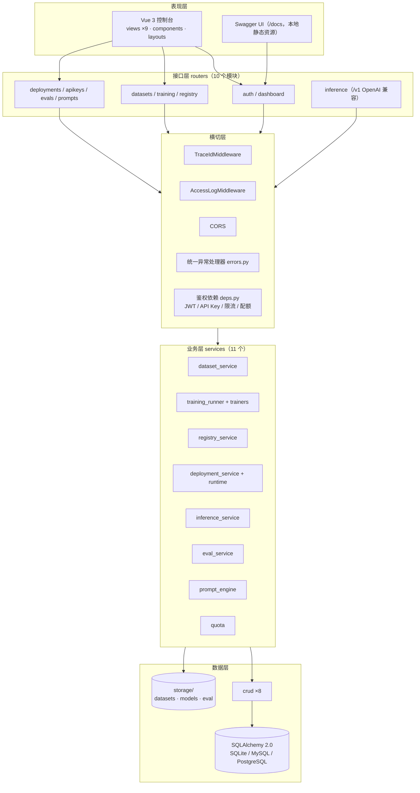
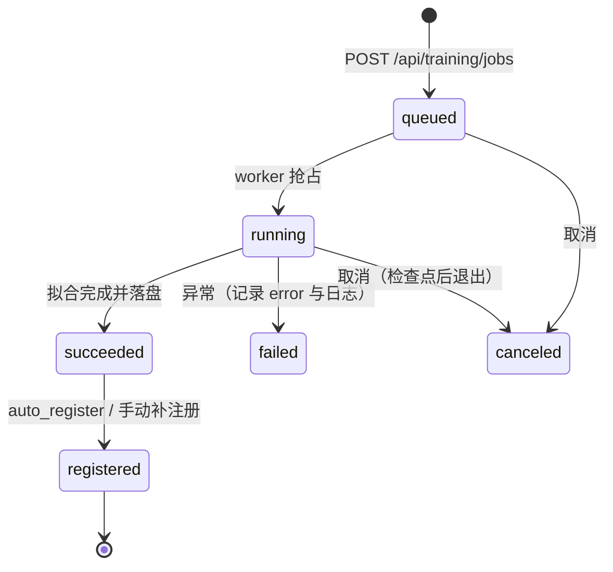
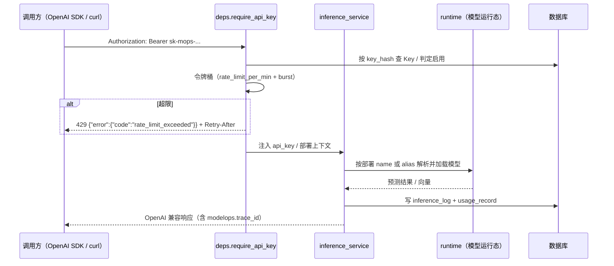

# 架构设计

> 对应代码：`backend/app`（FastAPI）、`frontend/src`（Vue 3）、`docker-compose.yml`

## 1. 总体分层

**依赖方向**：`routers → services → crud → models`。反向不依赖；`serializers` 只负责领域对象到 API 输出的投影，`schemas` 只负责 HTTP 契约校验，二者不包含业务规则。

## 2. 模块职责

| 目录 | 职责 | 关键约束 |
| --- | --- | --- |
| `app/routers/` | 参数校验、鉴权、调用 service、包信封 | 不写 sqlalchemy 查询 |
| `app/services/` | 业务规则、编排、事务 | 不依赖 request 对象 |
| `app/trainers/` | 训练算法实现（可插拔） | 只依赖 `BaseTrainer` 契约 |
| `app/crud/` | 查询与持久化 | 无业务判断 |
| `app/models.py` | 19 张表 ORM | 统一 `utcnow`、软删除不使用 |
| `app/schemas.py` | 请求/响应模型 | `extra="forbid"` 防脏字段 |
| `app/deps.py` | 两种鉴权：JWT（管理面）、API Key（推理面） | 推理面必须记账 |
| `app/errors.py` | 错误码与 OpenAI 风格错误体 | `/v1/**` 不用信封 |
| `app/logging_utils.py` | trace id 生成、访问日志 | 响应头带 `X-Trace-Id`、`X-Response-Time-Ms` |

## 3. 请求生命周期

以 `POST /api/training/jobs` 为例：

1. **TraceIdMiddleware**：读取或生成 `X-Trace-Id`，写入 context，响应头回传。
2. **AccessLogMiddleware**：记录方法、路径、状态码、耗时，异常也记。
3. **CORS**：浏览器跨域预检。
4. **路由依赖**：`Depends(require_user)` 解析 `Authorization: Bearer <JWT>`，失败抛 `UnauthorizedError(code=40100)`。
5. **Pydantic 校验**：`TrainingJobCreate` 校验字段，失败由异常处理器转 42200。
6. **Service**：校验数据集版本与超参 → 落库 `training_job(status=queued)` → 唤醒 worker。
7. **序列化**：`serializers.job_detail` → `envelope(data)` → `{"code":0,"message":"ok","data":...,"trace_id":"..."}`。

推理接口 `POST /v1/chat/completions` 走另一条依赖链：`require_api_key` → 取 Key 散列 → 令牌桶 → 配额 → `inference_service`，响应是 OpenAI 官方结构（附加 `modelops.trace_id`），限流时返回 `{"error":{...}}` + `Retry-After`。

## 4. 训练流水线

关键实现：

- `training_runner.py` 维护后台线程池（`WORKER_CONCURRENCY` 默认 2），按 `queued` 顺序取任务并置为 `running`；进程重启时把 `running` 的孤儿任务标记失败，避免永久卡住。
- 训练器在 `train()` 中通过回调写 `training_log` 与 `training_metric`，HTTP 侧用 `after_id` 增量拉取，避免重复传输。
- 产物写 `storage/models/job-<id>/model.joblib`，同时把大小与 SHA-256 记进 `training_job` 与 `model_version`，便于校验与展示。
- `TRAINING_INLINE=true` 时同步执行，测试用；默认异步。

## 5. 推理请求链路

要点：

- **路由解析**：`resolve_deployment` 先按 `deployment.name`，再按 `alias`，都找不到返回 404（OpenAI 风格错误体）。
- **懒加载**：`runtime_manager` 首次命中时反序列化模型并缓存；部署停止或删除时清理缓存。
- **上游 LLM 可选**：配置 `UPSTREAM_LLM_BASE_URL` + `UPSTREAM_LLM_API_KEY` 后，聊天接口可透传到真实大模型；未配置时由本地运行时给出确定性的可演示回答，保证离线可用。
- **记账优先**：无论成功失败都写日志，错误率与平均延迟直接从日志聚合，避免额外统计表漂移。

## 6. 部署运行时

| 形态 | 说明 |
| --- | --- |
| 本地开发 | uvicorn 127.0.0.1:8000 + Vite dev 5173（代理 `/api`、`/v1`） |
| 本地预览 | `vite preview` 4173/4417（同样带代理），用于验收与截图 |
| 容器 | Nginx 托管前端静态资源，`/api/`、`/v1/` 反代到 `backend:8000`，SSE 关闭 `proxy_buffering` |
| 数据库 | 本地 SQLite 文件；Compose 用 MySQL 8（`utf8mb4`），生产可换 PostgreSQL |

## 7. 关键设计决策

| 决策 | 选择 | 理由与代价 |
| --- | --- | --- |
| 训练执行方式 | 进程内线程池 + 数据库状态机 | 零依赖、演示够快；代价是无跨机调度，扩展需引入队列（Redis/Celery） |
| 默认模型 | TF-IDF + LogisticRegression | CPU 秒级、可解释、无需下载权重；作为 `BaseTrainer` 实现，可替换为深度模型 |
| 响应格式 | 管理面统一信封 + 推理面 OpenAI 原生 | 管理面便于前端统一处理；推理面对齐 OpenAI SDK，降低接入成本 |
| 鉴权 | 管理面 JWT、推理面 API Key | 两种流量敏感度不同，Key 可独立限额与吊销 |
| 错误码 | 三分类：信封 code、HTTP status、OpenAI error code | 前端与第三方都能按需判断；文档见 `docs/api.md` |
| 数据库 | SQLAlchemy 2.0 + `create_all` | 单机演示免迁移；生产应接 Alembic（见 `docs/database.md`） |
| 文档资源 | Swagger UI 静态文件本地托管 | 离线交付环境（如内网演示机）也能打开 `/docs` |

## 8. 扩展点

| 扩展需求 | 改哪里 | 说明 |
| --- | --- | --- |
| 新增训练器（如 PyTorch 图像分类） | `app/trainers/` 实现 `BaseTrainer` 并在 `__init__.py` 注册 | 需要实现 `validate` / `train` / `persist` |
| 新增推理后端 | `app/services/runtime.py` | 当前为 joblib 本地运行态，可换 Triton/vLLM/KServe 客户端 |
| 新增上游模型供应商 | `app/services/inference_service.py` | 已抽象为 OpenAI 兼容透传，换 base_url 即可 |
| 新增评测指标 | `app/services/eval_service.py` | 指标名需同步前端表格列 |
| 新增页面 | `frontend/src/views` + `router/index.ts` + `api/index.ts` | 路由 meta 自动进入侧边栏 |
| 换生产数据库 | `DATABASE_URL` + 安装驱动 | 建表语句由 ORM 生成，必要时先跑 Alembic |
